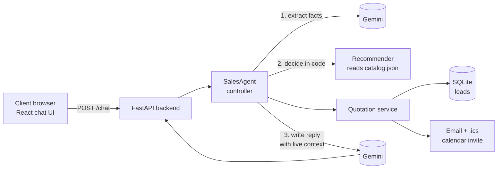
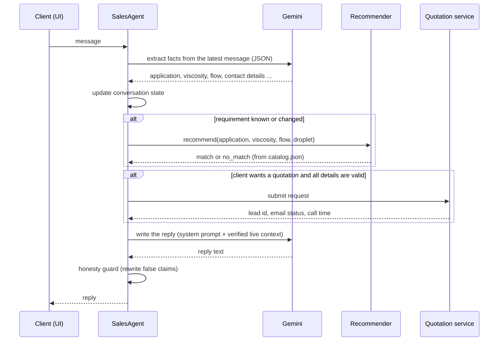

# Architecture

## Components

## One conversation turn

## Design decisions

**Product knowledge: structured catalog, not a vector database.** The catalog has about a dozen products,
so it is stored as `catalog.json`, rendered into the prompt for answering questions, and used directly by
the recommender. This avoids retrieval errors. For a catalog of hundreds of products, retrieval (RAG)
would be the next step.

**Recommendations come from code.** The recommender filters by viscosity and flow rate, scores by
application and droplet size, and returns reasons and warnings. The same input always gives the same
answer, and it is unit-tested.

**The model does not decide when to recommend or book.** In testing, Gemini often skipped tool calls and
answered from the prompt, once even claiming a booking that had not happened. The controller therefore
runs the recommender and the quotation in plain code and gives the model the verified result as live
context. The model only extracts facts and writes the reply.

**Conversation state lives in code.** Application, viscosity, flow rate, droplet size and contact details
are tracked per session. The state decides what to ask next, one or two questions at a time.

**Guards against known failure modes** (each came from a bug found in testing):
- numbers are only accepted when the client's message contains a digit (a stale value could be re-reported
  on a message like "yes");
- a new application clears the old numbers;
- after a request is submitted, a different person starts a new request instead of reusing the previous
  email and phone;
- a reply that claims "scheduled", "booked" or "emailed" before the system did it is rewritten.

**Reliability:** retries with backoff, a request timeout, an optional fallback model for 503 errors, and
emails saved to an outbox if SMTP is unavailable.

## Data flow of a quotation

1. The client agrees to a quotation and gives name, company, email, phone and a call time.
2. The service validates everything (email format, phone digits, product id, future date).
3. The lead is stored in SQLite.
4. An email with the catalog specs of the recommended product and a `.ics` invite is sent (or saved).
5. The assistant confirms exactly what happened, based on the returned status.